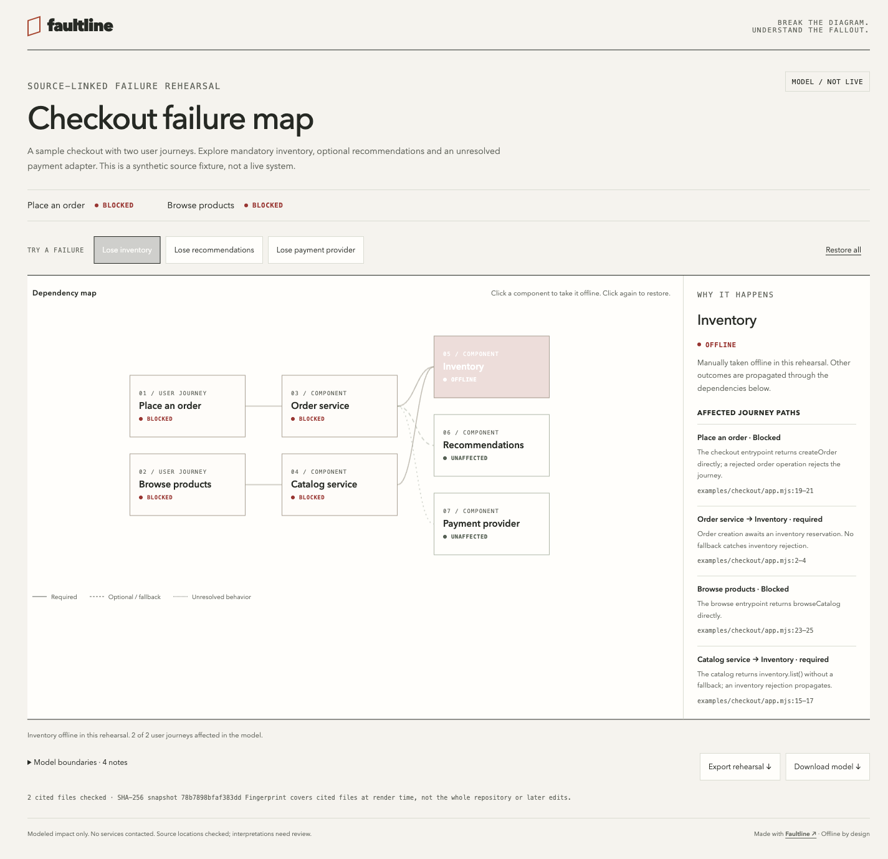

<div align="center">

# Faultline

**Click a dependency. See what breaks, and why.**

An Agent Skill that turns source code into an interactive, offline failure rehearsal.

[Try the demo](https://CuiYuYuan1.github.io/faultline-skill/) · [简体中文](README.zh-CN.md) · [Model format](references/model.md)

[](https://github.com/CuiYuYuan1/faultline-skill/actions/workflows/test.yml)
[](LICENSE)
[](https://nodejs.org/)

</div>

[](https://CuiYuYuan1.github.io/faultline-skill/)

“What happens if this service goes down?” A diagram shows connections. Faultline lets you rehearse the consequences: take inventory offline, lose recommendations, or investigate a payment provider whose adapter you haven't inspected yet. Follow the effect back to user journeys and read the source references behind each relationship.

## Try it in 30 seconds

[Open the interactive sample](https://CuiYuYuan1.github.io/faultline-skill/) and select:

| Failure | Modeled result | Why |
| --- | --- | --- |
| Inventory | Checkout and browsing **blocked** | Both await inventory operations without a fallback. |
| Recommendations | Checkout **degraded**, browsing unaffected | Recommendation failure becomes an empty list. |
| Payment provider | Checkout **unknown**, browsing unaffected | The injected adapter is missing; provider-outage behavior needs inspection. |

The sample is backed by a [small source fixture](examples/checkout/app.mjs) and [behavior tests](tests/checkout.test.mjs). It demonstrates a model, not a production outage.

## Install the skill

Requires an agent that can inspect local files and run **Node.js 22+**.

```bash
npx skills add CuiYuYuan1/faultline-skill --skill faultline
```

Choose your agent when prompted, or target it directly:

```bash
npx skills add CuiYuYuan1/faultline-skill --skill faultline --agent codex
# For Claude Code, use --agent claude-code instead.
```

Then ask your agent:

```text
Use faultline to map our checkout flow.
Show what happens when inventory, recommendations or payments go down.
Use the actual fallback code, and mark missing behavior as unknown.
```

The portable entrypoint is [SKILL.md](SKILL.md). Agents that do not support the installer can read it from a local clone. The renderer itself uses only Node's standard library; it needs no model API key or package installation.

## What you get

- **One offline HTML file.** Share it as a file, open it without a server, or publish it as static HTML. No CDN, fonts, telemetry or background requests.
- **Multiple failures.** Toggle individual components, use presets, and restore everything. Required, optional and unresolved relationships propagate differently.
- **Reasons you can inspect.** Each known relationship has a reason and source line references. The renderer checks paths and line ranges and fingerprints cited files.
- **A useful “unknown.”** Missing adapters and unresolved outage behavior remain visible instead of becoming invented guarantees.
- **Portable outputs.** Download the editable JSON model or export a Markdown rehearsal with the chosen failures, affected journeys, causal paths and boundaries.
- **Accessible controls.** Native buttons, keyboard operation, text status labels, reduced motion and a scrollable map on narrow screens.

Use it for architecture reviews, onboarding, incident tabletop discussions, or explaining why a fallback matters in a PR.

## Run the sample without an agent

```bash
git clone https://github.com/CuiYuYuan1/faultline-skill.git
cd faultline-skill
node scripts/faultline.mjs check examples/checkout.model.json --source .
node scripts/faultline.mjs render examples/checkout.model.json --source . --out checkout-map.html
```

Open `checkout-map.html` in a browser. Existing outputs are preserved; use a new filename for another render. `docs/index.html` is the already-rendered, standalone sample.

For your own repository, have your agent inspect a specific flow and write a model using [the model reference](references/model.md). Rendering reads only the files explicitly cited in that model and never executes the inspected repository.

## How it works

```text
Inspected source → dependency model → validation → offline HTML
                           ↑                           ↓
                   reasons + evidence          toggle failures
```

An edge `checkout → inventory` means checkout depends on inventory. A lost required dependency blocks its caller; a lost optional dependency degrades it; an unresolved relationship produces an unknown result. Effects propagate upstream. Across dependencies, the more severe modeled state wins. [Full semantics and limits](references/model.md#propagation-semantics).

The agent interprets source. The renderer validates the model's structure and source locations. Those are separate responsibilities: an existing file and line do not establish that an explanation is correct.

## Related projects

[Archify](https://github.com/tt-a1i/archify) covers interactive diagrams broadly. [repo-architecture-skill](https://github.com/JatinBhargava/repo-architecture-skill) provides source-linked architecture and request-flow exploration, including failure cases. Faultline focuses on a small outage-rehearsal workspace with explicit required/optional/unknown propagation and exportable scenarios. These tools overlap; choose the output you need.

For executable demonstrations, see [Showboat](https://github.com/simonw/showboat). For real fault-injection experiments, use a tool and environment designed for that purpose.

## Boundaries

This is a **Boolean dependency model**. It does not establish production health, capacity, latency, outage probability, conditional routing, retry behavior or recovery time. “Unaffected” means a selected failure does not reach that node in the model. Use a tightly scoped flow and review interpretations against the actual implementation.

The fingerprint covers cited files at render time. It is not a signature, whole-repository attestation or automatic stale-source detector. The HTML contains architecture names, explanations and source paths; review it before sharing. No source text or credentials are copied automatically.

## Develop and contribute

```bash
npm test
npm run check:demo
```

No `npm install` is required. Tests cover propagation, mixed failures, cycles, input validation, HTML-shaped strings, source containment, references and output preservation. Browser interaction checks are also needed for viewer changes.

Useful contributions are small, source-backed example maps, reproducible rendering bugs, better accessibility and corrections to an actual modeling mistake. See [CONTRIBUTING.md](CONTRIBUTING.md) and [SECURITY.md](SECURITY.md).

MIT © CuiYuYuan1. Built as a focused, independently usable skill.
