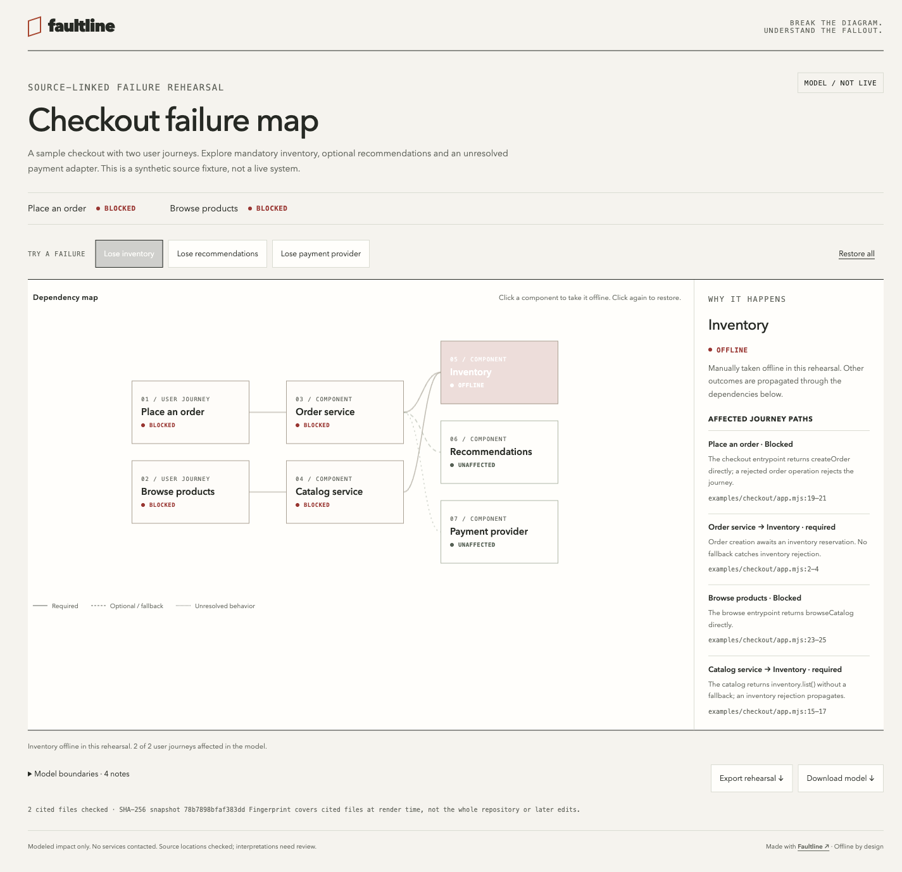

<div align="center">

# Faultline

**点掉一个依赖，看哪些功能会受影响，以及依据是什么。**

把源码变成可交互、可离线分享的故障推演图。

[在线体验](https://CuiYuYuan1.github.io/faultline-skill/) · [English](README.md) · [模型格式](references/model.md)

</div>

[](https://CuiYuYuan1.github.io/faultline-skill/)

“这个服务挂了会怎样？”Faultline 让 Agent 沿着代码读取依赖、错误传播和降级路径，再生成一个 HTML 文件。你可以点击组件模拟中断，追踪受影响的用户流程，查看原因与源码引用。

## 先体验

[打开示例](https://CuiYuYuan1.github.io/faultline-skill/)，切换三个场景：

| 中断对象 | 模型结果 | 依据 |
| --- | --- | --- |
| 库存 | 下单、浏览均被**阻断** | 两条路径都直接等待库存操作，没有回退。 |
| 推荐 | 下单**降级**，浏览不受影响 | 推荐异常被捕获，建议列表变为空，下单仍然完成。 |
| 支付供应商 | 下单结果**未知**，浏览不受影响 | 注入的支付适配器未提供，尚不知道供应商故障会如何转换。 |

示例配有[源码](examples/checkout/app.mjs)和[行为测试](tests/checkout.test.mjs)，用于演示模型，不代表线上故障验证。

## 安装

需要能读本地文件、执行命令的 Agent，以及 **Node.js 22+**。

```bash
npx skills add CuiYuYuan1/faultline-skill --skill faultline
```

按提示选择 Agent，也可直接指定：

```bash
npx skills add CuiYuYuan1/faultline-skill --skill faultline --agent codex
# Claude Code 使用 --agent claude-code。
```

然后告诉 Agent：

```text
使用 faultline 分析这个仓库的下单流程。
展示库存、推荐、支付服务故障会影响哪些功能。
降级路径必须有代码依据，缺少实现的部分标为未知。
```

[SKILL.md](SKILL.md) 是通用入口；不使用安装器的 Agent 也可以从本地克隆读取。渲染器只依赖 Node 标准库，无须模型 API Key 或安装项目依赖。

## 产物与能力

- **一个独立 HTML 文件**：无需服务器、外部字体或 CDN，可离线打开，也可作为静态文件发布。
- **组合故障**：逐个切换组件，或选预设场景；必需依赖、可降级依赖、未知行为分别传播。
- **查看原因**：已确认的依赖必须有解释和源码行号；渲染器核对路径、行号并记录被引用文件的指纹。
- **保留未知**：缺失的适配器、配置和恢复语义会留在图中，供进一步确认。
- **导出演练**：下载可编辑模型，或导出含故障、流程结果、传播路径和限制的 Markdown。
- **基础可访问性**：键盘操作、文字状态、减少动态效果、窄屏横向滚动图。

适合架构评审、项目交接、桌面故障演练，以及在 PR 中说明某条降级路径的作用。

## 不经过 Agent，直接运行示例

```bash
git clone https://github.com/CuiYuYuan1/faultline-skill.git
cd faultline-skill
node scripts/faultline.mjs check examples/checkout.model.json --source .
node scripts/faultline.mjs render examples/checkout.model.json --source . --out checkout-map.html
```

用浏览器打开 `checkout-map.html`。工具保留已有文件，再次生成时请换一个输出文件名。仓库中的 `docs/index.html` 是已经生成的独立示例。

分析自己的仓库时，让 Agent 读取一个明确流程，按[模型格式](references/model.md)生成 JSON。渲染器只读取模型明确引用的文件，不执行被分析仓库的代码。

## 工作方式与边界

Agent 负责理解代码；工具负责校验模型并生成交互图。`checkout → inventory` 表示下单依赖库存。必需依赖故障向上传播“阻断”，可降级依赖传播“降级”，未确认的关系传播“未知”。多个依赖同时受影响时保留更严重的模型状态，循环依赖也会收敛。

这是布尔依赖模型，不能据此推断线上健康、容量、延迟、故障概率、条件路由、重试或恢复时间。“不受影响”只表示当前模型没有传播到该节点。路径和行号存在，也不能证明 Agent 对代码的解释正确。

文件指纹仅覆盖生成时被引用的文件，不是整个仓库的证明，也不会自动检测之后的改动。HTML 包含架构名称、解释和源码路径，分享前应检查；工具不会自动复制源码正文或凭据。

## 相关项目

[Archify](https://github.com/tt-a1i/archify) 提供更广泛的交互图，[repo-architecture-skill](https://github.com/JatinBhargava/repo-architecture-skill) 提供源码关联的架构、请求流和故障场景探索。Faultline 聚焦于故障切换、必需/降级/未知状态传播和演练导出。需要可执行演示时，可以了解 [Showboat](https://github.com/simonw/showboat)。

## 开发与贡献

```bash
npm test
npm run check:demo
```

无需 `npm install`。测试覆盖传播、组合故障、循环、输入边界、HTML 特殊内容、引用路径和文件保护。修改界面还需要检查浏览器交互。

欢迎贡献小而真实、带源码依据的案例，提供可复现的渲染问题，改善可访问性，或纠正具体建模错误。参见 [CONTRIBUTING.md](CONTRIBUTING.md) 和 [SECURITY.md](SECURITY.md)。

MIT © CuiYuYuan1。
